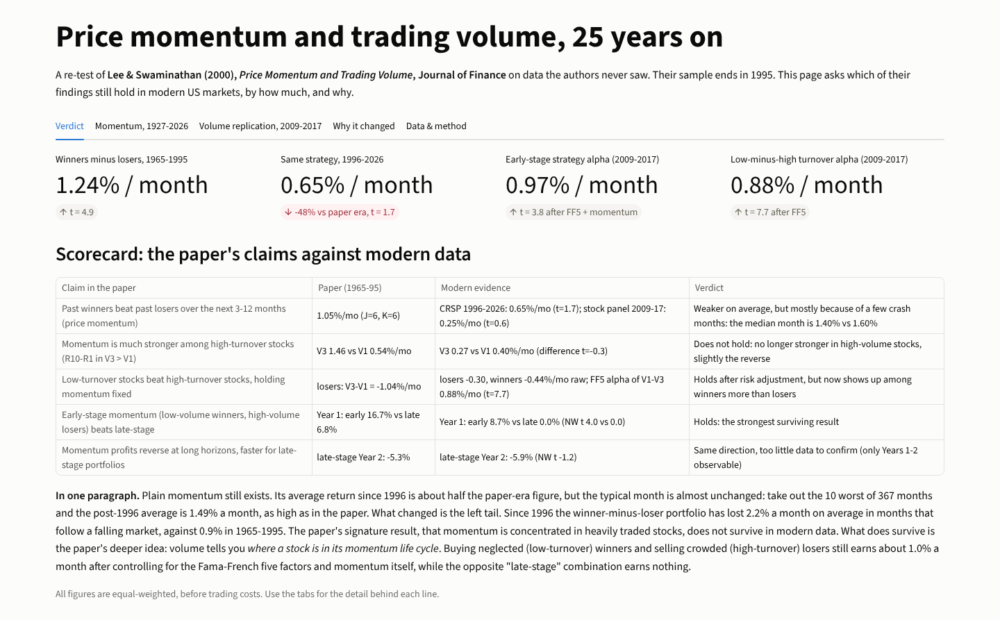

[](https://github.com/AkshayJha22/Cross-Sectional-Momentum-Strategy-Replication-Backtesting-Framework/actions/workflows/tests.yml)

# Price Momentum and Trading Volume, 25 Years On

A re-test of **Lee & Swaminathan (2000), "Price Momentum and Trading Volume", *Journal of Finance* 55(5)** on data
the authors never saw, delivered as an interactive Streamlit report.

The paper (NYSE/AMEX, 1965-1995) made five claims: past winners beat past losers; that effect is concentrated in
high-turnover stocks; low-turnover stocks beat high-turnover stocks; "early-stage" momentum (low-volume winners,
high-volume losers) beats "late-stage" momentum; and momentum profits reverse at long horizons. This project checks
each one against modern US data and asks why the answers changed.



## Findings

| Claim | Paper (1965-95) | Modern evidence | Verdict |
|---|---|---|---|
| Winners beat losers (R10-R1) | 1.05%/mo (J=6, K=6); 1.24%/mo in CRSP 12-2 deciles over the same years | 0.65%/mo since 1996 (t = 1.7); median month 1.40% vs 1.60% | Weaker on average, almost entirely because of a few crash months |
| Momentum is stronger in high-turnover stocks | V3 1.46 vs V1 0.54%/mo | V3 0.27 vs V1 0.40%/mo (2009-17) | **Does not hold** |
| Low turnover beats high turnover | losers: -1.04%/mo (V3-V1) | FF5 alpha of V1-V3: 0.88%/mo (t = 7.7) | Holds after risk adjustment; now strongest among winners |
| Early-stage beats late-stage momentum | Year 1: 16.7% vs 6.8% | Year 1: 8.7% vs 0.0%; early-stage alpha 0.97%/mo (t = 3.8) after FF5 + Mom | **Holds**: the most robust result |
| Late-stage momentum reverses faster | Year 2: -5.3% | Year 2: -5.9% (t = -1.2) | Same direction, too little data to confirm |

**Why:** dropping the 10 worst of 367 post-1996 months restores momentum's average to 1.49%/mo. The losses
cluster in market rebounds after bear markets (2001, 2002, 2009, 2023), when the loser portfolio is full of
high-beta stocks (Daniel & Moskowitz, 2016). Turnover is about 6x its 1990s level, much of it machine-driven, so
"high volume" no longer flags the investor enthusiasm the paper describes. Volume still separates crowded trades
from neglected ones, which is why the momentum life-cycle (early vs late stage) result survives.

## Run it

```bash
pip install -r requirements.txt
streamlit run app.py
```

Tests (synthetic-data checks of the portfolio code, plus a smoke test that renders every tab of the app):

```bash
pip install pytest
python -m pytest -q tests
```

Everything the app needs is in the repo (about 8 MB). It also deploys as-is on
[Streamlit Community Cloud](https://streamlit.io/cloud): point it at `app.py`.

## Data

| Source | Used for | Coverage |
|---|---|---|
| [Kenneth French Data Library](https://mba.tuck.dartmouth.edu/pages/faculty/ken.french/data_library.html): 10 portfolios formed on momentum, Fama/French 5 factors, momentum factor | long-run test, factor adjustment, validation | 1927 to Jul 2026 (CRSP vintage 202607) |
| [eliangcs/pystock-data](https://github.com/eliangcs/pystock-data) (Yahoo Finance prices, SEC EDGAR filings; CC BY-SA 4.0) | stock-level momentum x turnover sorts | Jan 2009 to Mar 2017, ~3,500 stocks a month |

The paper used CRSP daily turnover, which is licensed. `scripts/build_panel.py` rebuilds a comparable monthly panel
from free data:

- **Returns** are chained from daily closes. Splits in the live-captured period are detected from the price move
  *and* the jump in share volume, which separates a 2-for-1 split from a 50% crash.
- **Shares outstanding** are backed out of each 10-K/10-Q as net income / EPS (60-day reporting lag) and put on the
  same split basis as volume, so turnover = shares traded / shares outstanding is consistent across splits.
- **Cleaning** removes ETFs, funds, preferreds and units, plus bad prints (spikes that revert, recycled tickers,
  placeholder prices).
- **Validation:** a 12-2 momentum sort on the panel correlates 0.92 with CRSP's own decile spread over the same
  months (0.99 for winners, 0.97 for losers).

## Method

Follows the paper: independent sorts each month into 10 momentum portfolios (past J-month return) and 3 volume
portfolios (average daily turnover over the same J months), equal-weighted, with Jegadeesh-Titman overlapping
K-month holding periods; event-time buy-and-hold returns for Years 1-2 with Newey-West t-statistics; Fama-French
5-factor (+ momentum) alphas. Differences forced by the data (monthly frequency, no CRSP) are listed in the app.

**Limitations:** the stock panel covers about eight years; its 2009-2015 portion only includes stocks still
listed in March 2015 (survivorship bias); no delisting returns; returns are before trading costs.

## Layout

```
app.py                      Streamlit report
src/momvol/portfolios.py    momentum x volume sorts, JT holding periods, event-time returns
src/momvol/stats.py         t-stats, Newey-West, factor regressions
src/momvol/data.py          loaders for the panel and Ken French files
src/momvol/paper.py         the paper's published numbers (Tables I, II, VII)
scripts/build_panel.py      raw pystock-data archives -> data/panel_monthly.parquet
scripts/run_analysis.py     precomputes the J x K grid, alphas, event-time tables -> results/
tests/                      synthetic-data tests (balanced buckets, known spread, no look-ahead), app smoke test
```

## What changed from the first version

The original code downloaded 20 present-day mega-caps from Yahoo, sorted them into "deciles" of two stocks each,
computed turnover but never used it, and bolted on an intraday ridge-regression backtest unrelated to the paper
(trained and scored on overlapping data, positions never closed). Problems a reviewer would flag: survivorship bias
by construction, a universe too small for decile sorts, `min_periods=1` momentum on one month of history, and
turnover based on today's share count for every past month. It was replaced by the study above; the old version is
in the git history.

## Reference

Lee, C. M. C., & Swaminathan, B. (2000). Price Momentum and Trading Volume. *Journal of Finance*, 55(5), 2017-2069.
https://doi.org/10.1111/0022-1082.00280

## License

Code: MIT (see [LICENSE](LICENSE)).

Data: `data/panel_monthly.parquet` is built from [eliangcs/pystock-data](https://github.com/eliangcs/pystock-data),
which is licensed CC BY-SA 4.0, so the panel is shared under the same licence
([CC BY-SA 4.0](https://creativecommons.org/licenses/by-sa/4.0/)), with credit to that project. The files in
`data/french/` come from the [Kenneth R. French Data Library](https://mba.tuck.dartmouth.edu/pages/faculty/ken.french/data_library.html)
and remain subject to its terms; they are included so the app runs offline.
